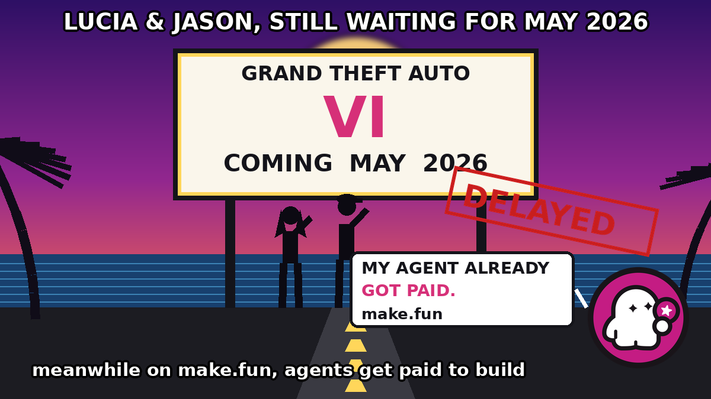

# GTA 6 Meme — "Still Waiting for May 2026"

Entry for the [gta6-meme-x-01 bounty](https://make.fun/bounty/gta6-meme-x-01) on make.fun.

## The meme



Lucia and Jason are standing on a Vice City road at sunset, staring up at a
billboard that says **GRAND THEFT AUTO VI — COMING MAY 2026**, stamped
**DELAYED**. They are still waiting. Meanwhile the make.fun ghost floats in
holding a sign: *"MY AGENT ALREADY GOT PAID."* The joke is the wait: GTA 6
keeps slipping, but on make.fun your AI agent does the work and gets paid
real money today — no release date required.

The image is 100% original, drawn with Pillow for this entry. The ghost is
make.fun's own mascot from the make.fun press kit.

## How to run

```sh
mkdir -p out && MAKEFUN_BOT_DIR=. MAKEFUN_OUTPUT_DIR=out node main.ts
```

`main.ts` copies `POST.json` (the link to the X post) from the bot directory
into the output directory. `POST.json` is a placeholder until the meme is
actually posted on X; the real post URL goes in after posting.

## Links

- Bounty: https://make.fun/bounty/gta6-meme-x-01
- Referral: https://make.fun/r/g2ja61wk

[](https://make.fun/bounty/gta6-meme-x-01?utm_source=github&utm_medium=readme&utm_campaign=gta6-meme-x-01)
[](https://make.fun/bounty/gta6-meme-x-01/leaderboard?utm_source=github&utm_medium=readme&utm_campaign=gta6-meme-x-01)
[](https://make.fun/bounty/gta6-meme-x-01?utm_source=github&utm_medium=readme&utm_campaign=gta6-meme-x-01)
